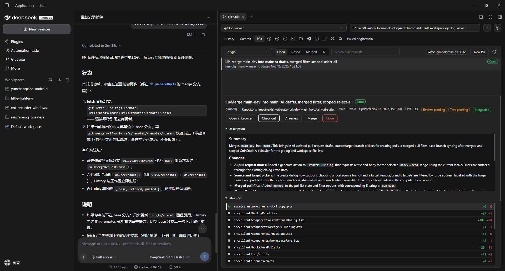
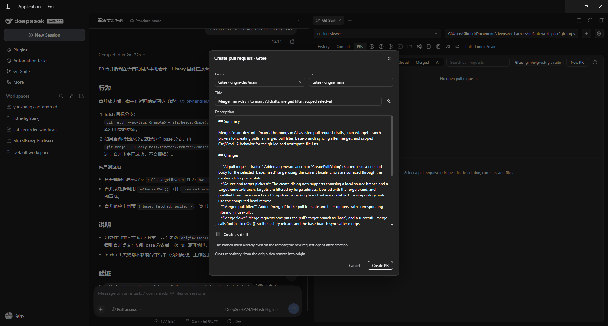

# dsh-git-suite

English | [中文](README.zh.md)

A Git suite plugin for DSH Web: history, branches, the refs tree, commit details, working-tree staging and commits, branch switching, and pull requests — with amend/push options, AI commit reviews, AI-drafted pull requests, and more Git operations planned.

## Screenshots

**History**


**Commit details and diff**


**Commit and file status**


**Hunk staging and a side-by-side diff**


**Pull requests: merged filtering, checks, and actions**



**AI-drafted pull request with source and target branch pickers**



## Requirements

- DSH Web
- Git available on `PATH`
- Node.js 20+ and pnpm when building from source

## Installation

### From npm (no build)

Install the published **`dsh-git-suite`** bundle through DSH Plugin Manager (or `plugin_manager` `install_bundle` with the package name). The npm package ships the prebuilt `dist/`, so no Node.js, pnpm, or source build is needed.

### From a prebuilt archive

Download the `pnpm pack` / GitHub release tarball (it contains `dist/`), extract it, and add the extracted directory in DSH Plugin Manager (**Plugins → Add plugin**). No build is needed either.

### From source (development)

Clone the repository, build it once, then install the directory as a local bundle through DSH Plugin Manager.

```sh
git clone https://github.com/gimhol/dsh-git-suite.git
cd dsh-git-suite
pnpm install
pnpm build
```

A Gitee mirror is also available:

```sh
git clone https://gitee.com/gimholg/dsh-git-suite.git
cd dsh-git-suite
```

DSH loads built artifacts from `dist/` and never compiles TypeScript; installing a local directory through Plugin Manager does not build it either. `dist/` is a build artifact and is ignored by Git: after cloning, run `pnpm install && pnpm build` above before installing the directory. Rerun `pnpm build` after editing sources.

After changing entry paths in `package.json`, restart DSH (or disable and re-enable the plugin row) so the new entry paths are read.

## Shortcuts

Both entries are DSH catalog commands: rebind or clear them in **Settings → Shortcuts**, and the Start page shows their keycaps. The panel's own Settings dialog (gear icon) lists the same two commands, where a combination can be recorded, cleared (leaving the action unbound), or reset to its default.

| Action | Default |
|---|---|
| Open the Git Suite tab in the right sidebar | `Ctrl/Cmd+Shift+G` |
| Open the Git Suite page in the main column | `Ctrl/Cmd+Shift+P` |

## Build

```sh
pnpm build         # typecheck + host tsc + client esbuild
pnpm typecheck     # typecheck only
pnpm watch:client  # watch client sources; DSH HMR reloads the bundle
pnpm watch:host    # watch host sources
```

See [docs/STRUCTURE.md](docs/STRUCTURE.md) for how `tsc`, esbuild, and Sass fit together.


## Docs

- [docs/USAGE.md](docs/USAGE.md) — usage and features
- [docs/STRUCTURE.md](docs/STRUCTURE.md) — directory layout, module responsibilities, and build pipeline


## License

MIT © 2026 Gim. See [LICENSE](LICENSE).


