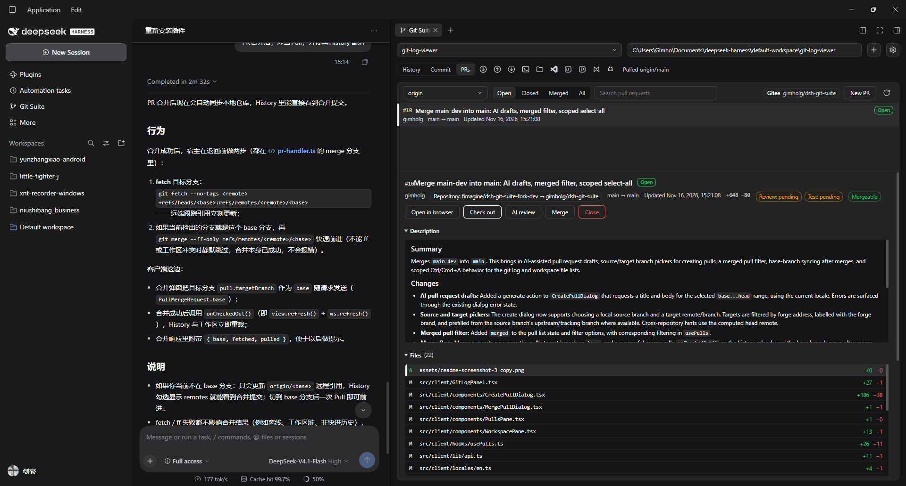
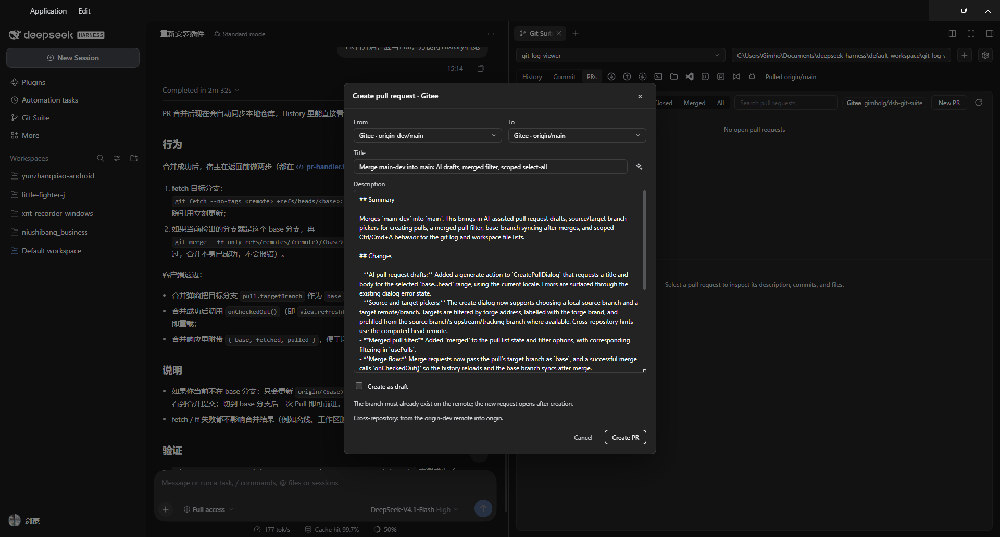

# dsh-git-suite

[English](README.md) | 中文

DSH Web 的 Git 套件插件：提供提交历史、分支、引用树、提交详情、文件状态/暂存/提交、分支切换与 Pull requests，支持提交后可选的修改/推送、AI 提交评审与 AI 起草 PR，后续继续扩展更多 Git 操作。

## 截图

**提交历史**


**提交详情与差异**


**提交与文件状态**


**按块暂存与分栏差异**


**Pull requests：已合并筛选、检查与操作**



**AI 起草 Pull request：可选源分支与目标分支**



## 环境

- DSH Web
- `PATH` 中有 Git
- 从源码构建时需要 Node.js 20+ 与 pnpm

## 安装

### 从 npm 安装（无需编译）

通过 DSH 插件管理器（或 `plugin_manager` 的 `install_bundle`，包名 `dsh-git-suite`）安装已发布的 bundle。npm 包内已带构建好的 `dist/`，用户无需 Node.js、pnpm，也无需从源码编译。

### 从预构建包安装

下载 `pnpm pack` / GitHub Release 的 tarball（内含 `dist/`），解压后把目录添加到 DSH 插件管理器（**Plugins → Add plugin**），同样无需编译。

### 从源码安装（开发）

克隆仓库、构建一次，再通过 DSH 插件管理器把该目录安装为本地 bundle。

```sh
git clone https://github.com/gimhol/dsh-git-suite.git
cd dsh-git-suite
pnpm install
pnpm build
```

也可以从 Gitee 镜像克隆：

```sh
git clone https://gitee.com/gimholg/dsh-git-suite.git
cd dsh-git-suite
```

DSH 只加载构建产物（`dist/`），不会编译 TypeScript；插件管理器安装本地目录时也不会替你构建。`dist/` 是构建产物，已被 Git 忽略：克隆后请先执行上面的 `pnpm install && pnpm build`，再安装该目录。修改源码后重新执行 `pnpm build`。

修改 `package.json` 中的入口后，需要重启 DSH（或在插件页禁用再启用该插件），让新的入口路径生效。

## 快捷键

两条都是 DSH 命令，可在 **设置 → 快捷键** 中改键或清除，Start 页的 Git 卡片上也会显示键帽。面板自己的设置弹窗（齿轮）里也列出了这两条命令，可以录制新组合键、清除（允许不设置）、或恢复默认。

| 操作 | 默认快捷键 |
|---|---|
| 在右侧栏打开 Git Suite | `Ctrl/Cmd+Shift+G` |
| 在主列打开 Git Suite 页面 | `Ctrl/Cmd+Shift+P` |

## 构建

```sh
pnpm build         # 类型检查 + 宿主端 tsc + 客户端 esbuild
pnpm typecheck     # 仅类型检查
pnpm watch:client  # 监听客户端源码，DSH HMR 会重新加载产物
pnpm watch:host    # 监听宿主端源码
```

构建管线（`tsc` / `esbuild` / Sass 的分工）见 [docs/STRUCTURE.zh.md](docs/STRUCTURE.zh.md)。


## 文档

- [docs/USAGE.zh.md](docs/USAGE.zh.md) — 使用与功能
- [docs/STRUCTURE.zh.md](docs/STRUCTURE.zh.md) — 目录布局、模块职责与构建管线


## 许可证

MIT © 2026 Gim。详见 [LICENSE](LICENSE)。


